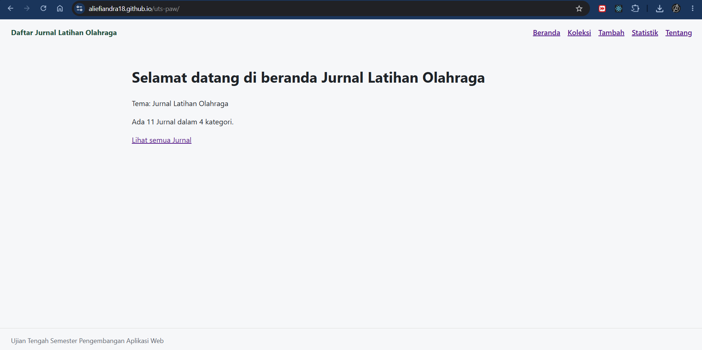
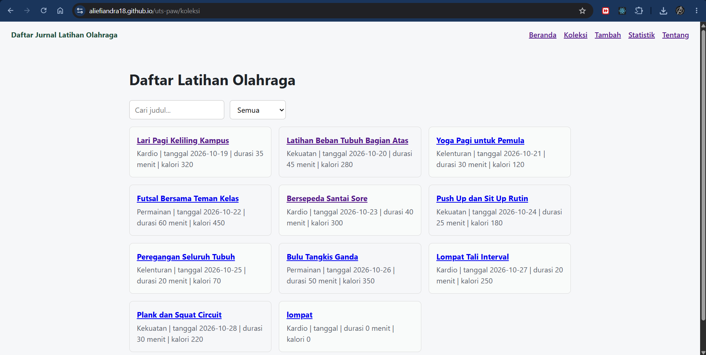
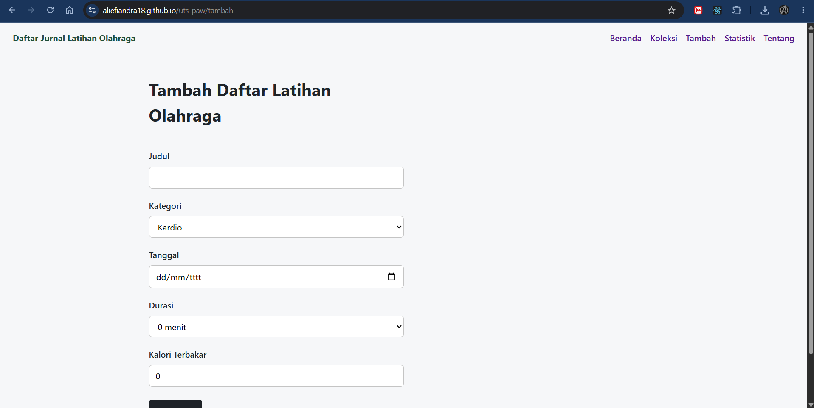
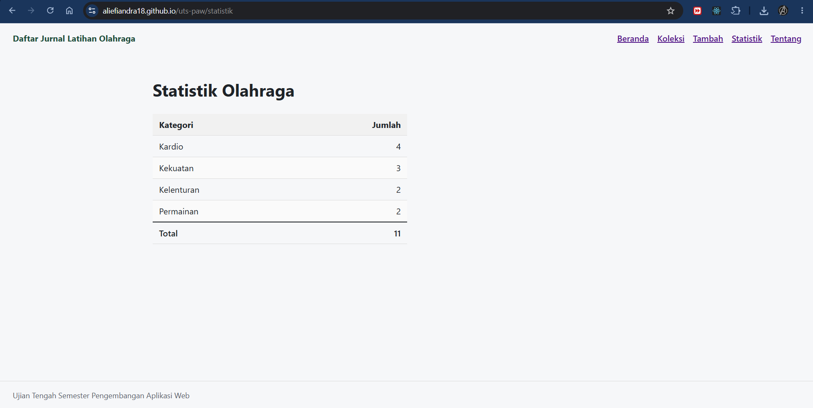
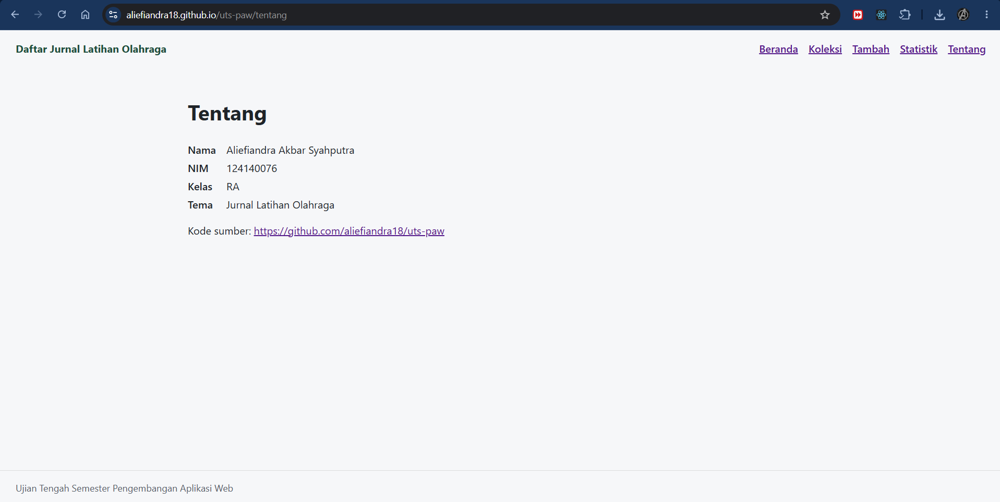
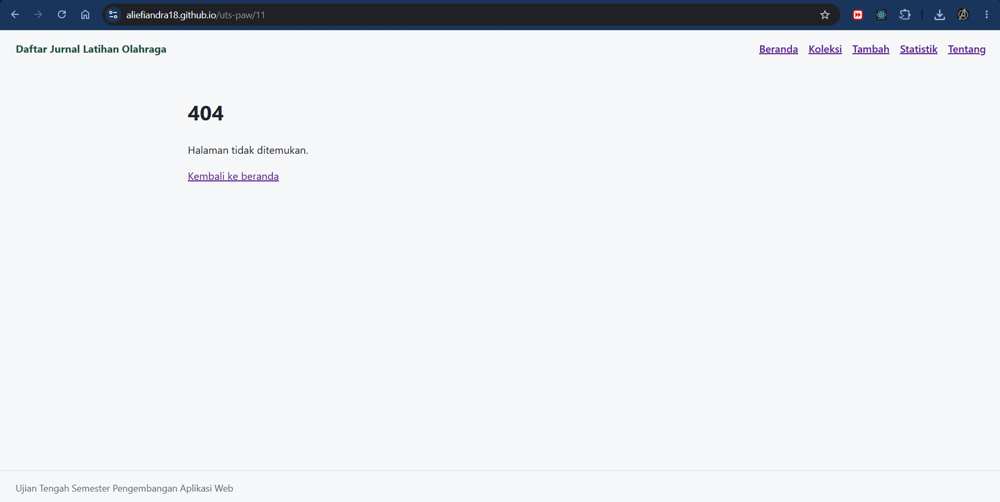

# Nama Aplikasi

- Nama: Aliefiandra Akbar Syahputra
- NIM: 124140076
- Kelas: RA
- Tema: Jurnal Latihan Olahraga
- Deployment: https://aliefiandra18.github.io/uts-paw/

## Tampilan Aplikasi

- Halaman Beranda

- Halaman Koleksi

- Halaman Tambah

- Halaman Statistik

- Halaman Tentang

- Halaman 404

## Fitur

- Beranda: Menampilkan ringkasan jumlah jurnal latihan dan kategori olahraga.

- Koleksi: Menampilkan daftar latihan olahraga yang sudah tersimpan.

- Pencarian: Mencari jurnal latihan berdasarkan judul.

- Filter kategori: Menyaring daftar latihan berdasarkan kategori olahraga.

- Tambah latihan: Menambahkan jurnal latihan baru dengan mengisi judul, kategori, tanggal, durasi, dan kalori terbakar.

- Detail latihan: Melihat informasi lengkap dari jurnal latihan yang dipilih.

- Hapus latihan: Menghapus jurnal latihan yang sudah tidak diperlukan.

- Statistik: menampilkan jumlah latihan berdasarkan kategori.

- Penyimpanan data: Menggunakan localStorage agar data tetap tersimpan meskipun halaman dimuat ulang.

## Menjalankan secara lokal

- cd app
- npm install
- npm run dev

## Konsep React yang dipakai

- useState: Mengelola data dan perubahan tampilan, seperti input formulir, pencarian, dan filter kategori.

- useEffect: Menjalankan proses tertentu, seperti mengambil data awal dan menyimpan perubahan data.

- Context API: Membagikan data jurnal latihan ke beberapa halaman tanpa harus mengirim props secara berulang.